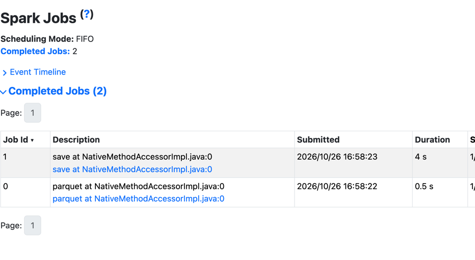
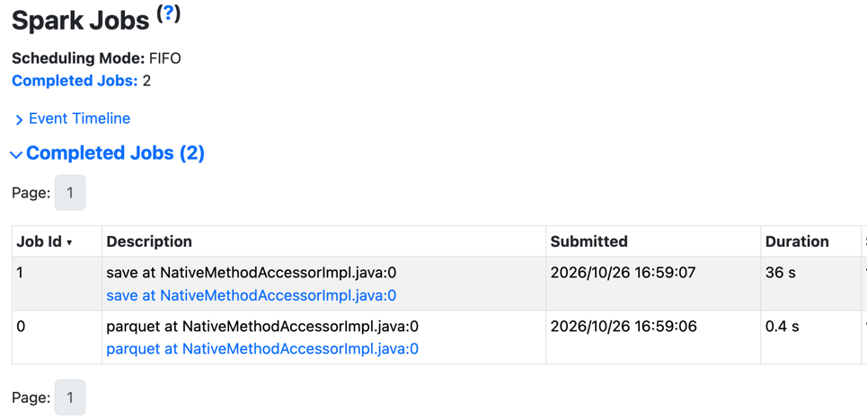

# Explode and filter array vs. explode and filter row

1. Create the virtual env:
```shell
uv sync
```

2. Generate dataset:
```shell
uv run generator.py
```

3. Explain  [explode_filter.py](explode_filter.py):
* `explode()` turns every item into its own row: 16 000 000 orders become 800 000 000 rows
* the cancelled rows are filtered out from the exploded part

4. Run the [explode_filter.py](explode_filter.py):
```shell
uv run python explode_filter.py
```
All the 2 operations, so filtering and explode, should be executed as a single loop, leading to faster execution times:



5. Explain the [filter_explode.py](filter_explode.py)
* here we are filtering with the help of a Higher-Order Function (`filter`)
  * the outcome will be a new array with the rows respecting the filtering logic only 

6. Run the [filter_explode.py](filter_explode.py)
```shell
uv run python filter_explode.py
```

The execution should be slower because the code generation only concerns the Apache Parquet-to-Apache Spark row conversion.
The filtering happens in another operator:

